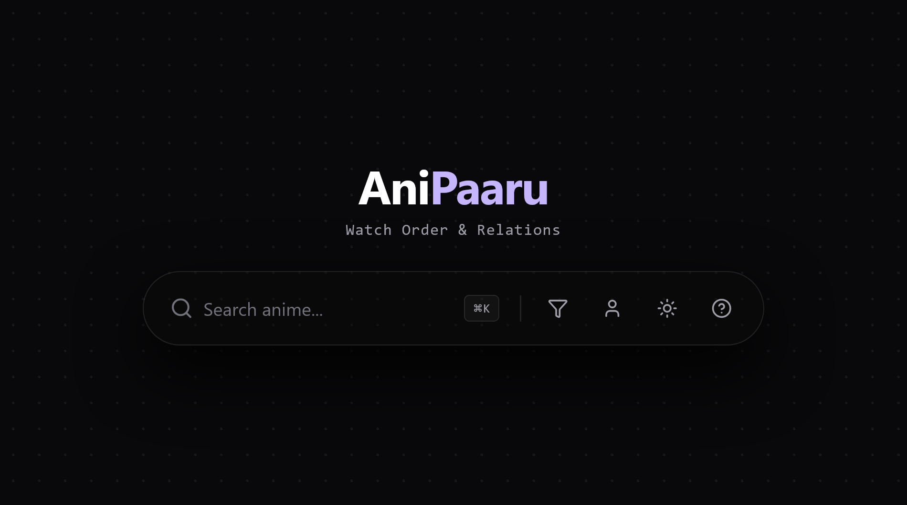
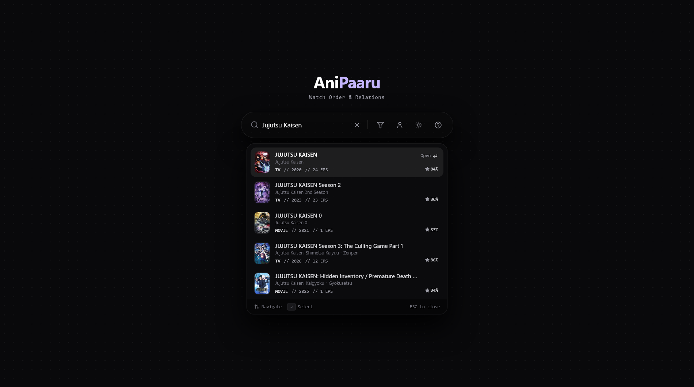
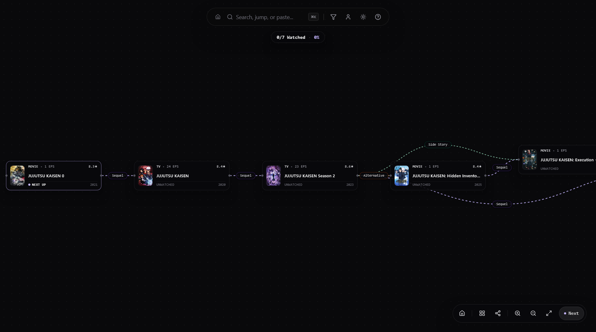
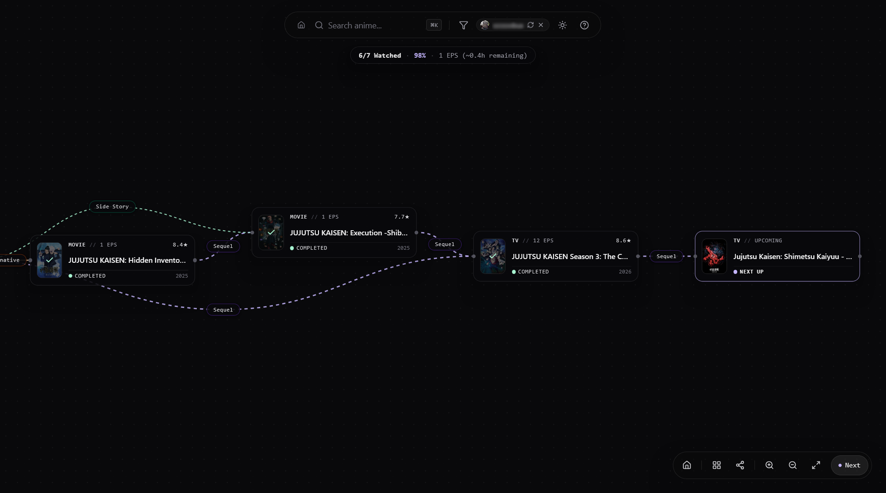
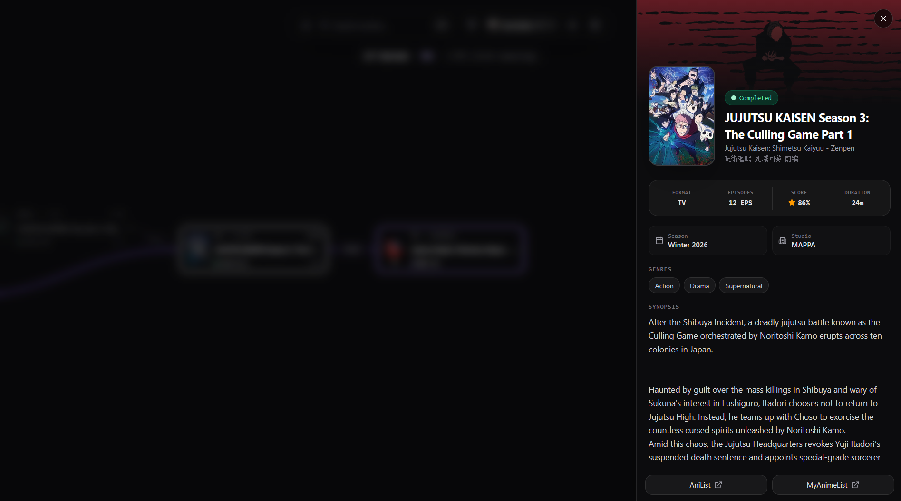

# AniPaaru

Interactive anime watch order and relation graph visualizer powered by the AniList API.

## Preview

 

  
Home

  

 

  
Search

  

 

  
Timeline View

  

 

  
with AniList Sync (no login required)

  

 

  
Details Modal

  

## Features

- **Relation Mapping**: Displays direct canonical sequels, side stories, spin-offs, and alternative settings.
- **AniList Integration**: Enter your AniList username to overlay watch status directly onto graph nodes, along with progress stats and remaining episode hours.
- **Next Up Detection**: Automatically identifies the next entry to watch once all previous storyline prerequisites are completed.
- **Order Modes**: Toggle between production release order and in-universe chronological timelines.
- **Path Tracing**: Hover or click an anime node to highlight its entire ancestry chain from the original series to the latest sequel.
- **Progressive Web App**: Installable PWA with dark and light theme support.

## Attribution

All anime metadata and user list information is provided by the [AniList API](https://anilist.gitbook.io/anilist-apiv2-docs).
